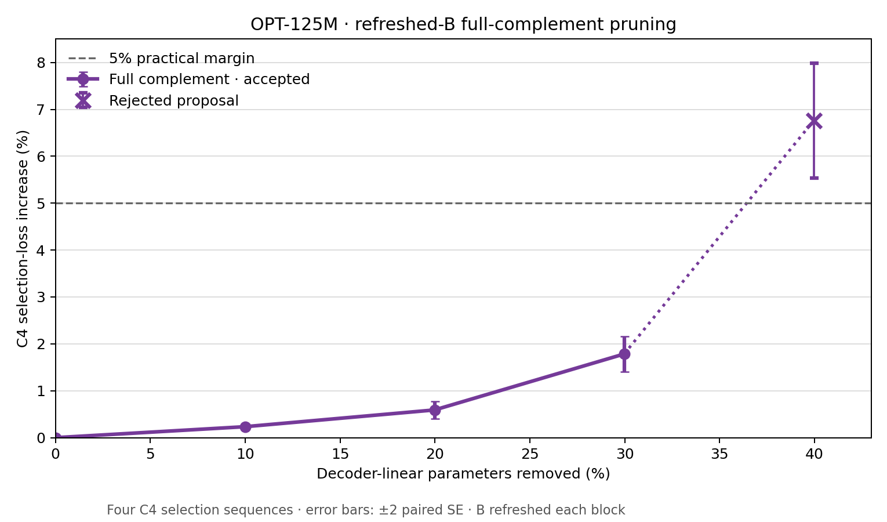

# Pruning project: methods and current evidence

## Research question and common formulation

Our Fisher-based pruning methods describe a move using two sets: $D$, parameters fixed to a constant (currently zero), and $U$, surviving parameters allowed to change by an amount $u$. Their combined change is $\Delta(D,u)$.

We need a cheap way to judge possible moves before measuring their actual loss. We use a quadratic approximation around the current model, represented by a positive-semidefinite matrix $F$. Choosing that matrix is itself a modeling decision: it may be a full-model Fisher estimate or a cheaper local approximation. Loss validation remains part of the procedure, determining whether a proposed move is accepted; it does not become unnecessary because we use a proxy.

The family of objectives we study is

$$
\mathcal J(D,u)=\tfrac12\Delta(D,u)^\top F\Delta(D,u)
+\tfrac{\mu}{2}\|u\|_2^2
+\lambda_u|\operatorname{supp}(u)|
-\lambda_d K(D).
$$

The terms estimate damage from the whole move, discourage large updates, charge for updating many weights, and reward structural savings $K(D)$, respectively. Canonicalization can remove connections made redundant by a deletion while preserving the represented function, under the conditions handled by the canonicalizer. Individual branches may set some coefficients to zero; Classic's structural moves are separate baselines.

For a **fixed** $D$, if all eligible survivors may change and the update-count penalty is absent, the best update for this quadratic solves

$$
(F_{UU}+\mu I)u=-F_{UD}d,\qquad d=-\theta_D.
$$

Here $K(D)$ is already fixed, so it does not obstruct this update solve. The difficult part is selecting $D$: that remains discrete even when we omit canonicalization from the search.

We use two operational modes:

- **Rank, then solve.** Score each possible single deletion using the Optimal Brain Surgeon (OBS) formula $s_i=\theta_i^2/[2(F^{-1})_{ii}]$ for an invertible or damped $F$. It allows all other eligible weights to compensate in that *one-deletion* calculation. Take the lowest scores to form $D$, then solve the quadratic for its surviving weights. The update is the conditional optimum up to numerical tolerance; combining many individually attractive deletions is a heuristic, since their interactions were not considered while ranking.
- **Joint support search.** On the smaller MLP, a Gurobi mixed-integer quadratic program chooses deletion blocks and a limited set of compensating coordinates together and rewards canonicalized parameter savings. Its candidate blocks are ranked before solving, so it searches a bounded pool rather than every possible model change. This is much more expensive.

## Current results

**Berman SimpleNN/MNIST.** The global Fisher General MIQP is the clearest positive result. It uses a full-model empirical Fisher, chooses among ranked batches of weight deletions and a small update pool, and rewards additional parameters removed by canonicalization. At roughly **50% parameter removal**, the retained comparison figure shows held-out test loss around **$0.97\times$ the original**, versus about **$1.05\times$** for the Berman iterative baseline at similar removal. The MIQP's deletion and update choices are made together within its candidate pool; the Berman baseline ranks individual weights by a diagonal Fisher score, deletes them in 10-percentage-point increments, and makes no compensating updates. These numbers are approximate readings of an [archived figure](../plots/berman/comparison.png); its original numeric result files were not transferred into Forge.

**OPT-125M.** The strongest internal full curve currently uses Fisher-aware SparseGPT: $A\otimes B$ scores help choose deletions within input-column blocks, while compensation is mostly SparseGPT's sequential $A$-based propagation. Its apparent advantage over native SparseGPT in the [archived comparison](../plots/opt/comparison_legacy.png) is **preliminary**, because evaluation offsets, actual removal, and other settings are not fully matched.

We also tested a cleaner quadratic branch on OPT: estimate a layer-local Fisher as $A\otimes B$, rank deletions once per linear module, then let *all* surviving module weights compensate. With $B$ refreshed from 16,256 sampled gradient observations before every transformer block, the completed Forge run produced:

| Target deletion | Actual removal | C4 selection-loss increase | Decision |
|---:|---:|---:|:---|
| 10% | 9.99% | 0.234% | Accepted |
| 20% | 19.98% | 0.591% | Accepted |
| 30% | 29.97% | 1.784% | Accepted |
| 40% | 39.96% | 6.759% | Rejected; run stopped |

The figure uses **four C4 selection sequences**; its error bars are twice the paired standard error. The 10% result is consistent with a separate diagnostic: on 128 held-out sequences, full complement increased loss by 0.215%, versus 0.255% for a Fisher-aware SparseGPT reference. But the methods removed 9.99% and 11.05% of parameters, respectively. Two sequential $A\otimes B$ variants in that diagnostic were better still (0.189% and 0.191%). The apparent 10% advantage therefore is not a matched update-rule comparison, and the higher-sparsity curve does not support replacing the sequential branch yet.

## Interpretation and next question

The project has one Fisher-based objective but **two different promising implementations**: bounded MIQP with a full-model Fisher and structural reward on Berman, and a sequential local approximation on OPT. That is a coherent methodological family, but it is not yet evidence that one algorithm beats both baselines. The current question is whether the OPT full-complement shortfall comes mainly from its one-pass deletion mask or from the local quadratic being a poor predictor of real loss after broad updates. A matched-mask diagnostic is configured to separate those effects. The [implementation reference](implementation_reference.md) records the exact algorithms, settings, and comparison limits for further analysis.
